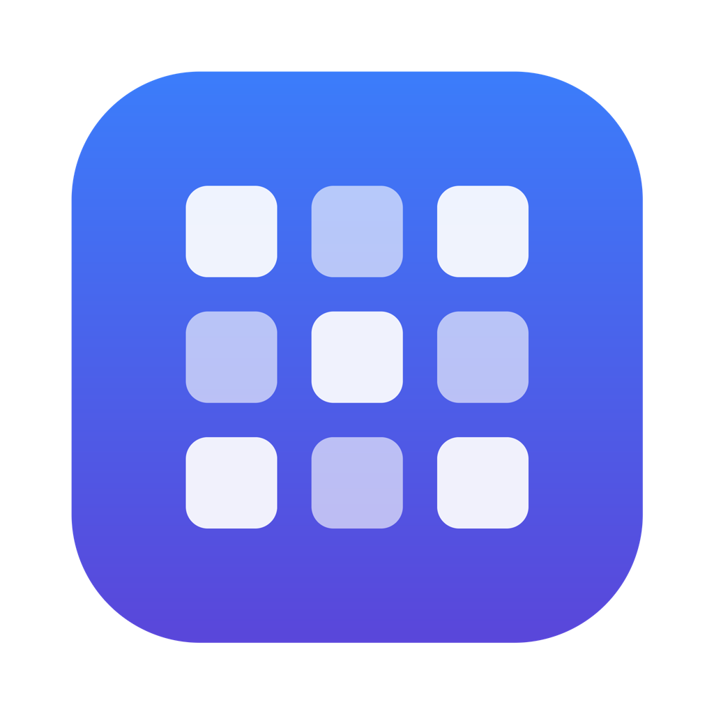
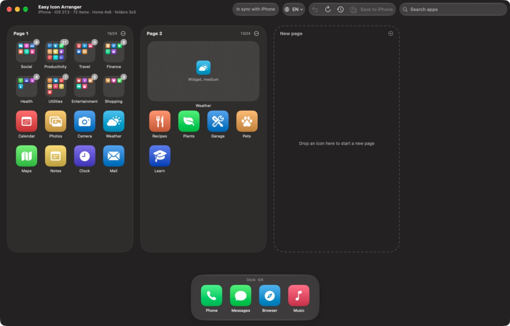

<p align="center">
  
</p>

<h1 align="center">Easy Icon Arranger</h1>

<p align="center">
  Rearrange your iPhone Home Screen from your Mac with drag and drop.<br>
  No iPhone Mirroring needed, so it works in the EU too.
</p>

<p align="center">
  
</p>

## Why

Moving dozens of icons and folders on the phone itself is slow and fiddly.
macOS has iPhone Mirroring, but it is not available in the European Union.
Easy Icon Arranger talks to the iPhone over a USB cable, shows every Home
Screen page, the Dock and your folders on the Mac, and writes the new layout
back to the phone in one step.

### What about Apple Configurator?

Apple Configurator can edit the Home Screen layout too, but only on
supervised devices, and turning on supervision means erasing the iPhone and
setting it up again. Easy Icon Arranger works with the iPhone you already use,
as it is: no supervision, no erase, no profiles. It also keeps widgets in
place and lets you put apps in any position on a page.

## Features

- All Home Screen pages, the Dock and folders, with the real app icons
- Drag and drop between pages, into and out of folders, into the Dock
- Folders shown exactly as on the iPhone (3x3 pages), including partly filled folder pages
- Multi selection: move many apps at once, or make a new folder from a selection
- Sort a folder alphabetically, rename or ungroup it
- Add, delete and reorder pages
- Search with highlight across pages and folders
- Widgets and web clips are kept and placed by their real size
- iOS-like reflow: a full page pushes its last icon to the next page
- Undo (200 steps)
- Automatic backup before every save and every restore, with a one-click restore
- Safe saves: the app refuses to write if the phone layout changed in the meantime, then checks the result after writing
- Available in all 24 official EU languages, following the macOS language (or pick one in the toolbar)
- Native SwiftUI app with Liquid Glass, small and fast

## Requirements

- A Mac with Apple silicon and macOS 26 Tahoe or later
- An iPhone connected with a USB cable, unlocked, that already trusts this Mac
  (connect it once and tap "Trust" on the phone)

No apps, profiles or jailbreak are needed on the iPhone. Easy Icon Arranger
uses the SpringBoard service that Apple's own tools use to read and write the
Home Screen layout.

## Install

1. Download `Easy-Icon-Arranger.zip` from the [latest release](../../releases/latest)
2. Unzip it and move `Easy Icon Arranger.app` to Applications
3. The app is not signed with an Apple Developer ID yet, so macOS blocks the first launch.
   Open it once, then go to System Settings, Privacy and Security, and click "Open Anyway".
   Alternatively, in Terminal:

   ```sh
   xattr -dr com.apple.quarantine "/Applications/Easy Icon Arranger.app"
   ```

## How to use

1. Connect and unlock the iPhone, then open Easy Icon Arranger
2. Drag icons where you want them. Drop an app on a folder to add it, hover over a folder to open it
3. Press Save (Cmd+S). The layout appears on the phone within a few seconds

Backups are stored in `~/Library/Application Support/Easy Icon Arranger/Backups`
and can be restored from the Backups window (Shift+Cmd+B).

## Limitations

- USB only. Wi-Fi sync is not supported
- Apps cannot be installed, deleted or hidden, and the App Library is not shown
- Widget stacks and widget contents cannot be edited, only moved
- Focus mode pages and Home Screen customisation (tint, dark icons) are not touched

## Build from source

Requirements: Go 1.26+, Swift 6.2+ (Xcode 26 or the Command Line Tools), macOS 26 SDK.

```sh
git clone https://github.com/pasqualesimonetti/easy-icon-arranger.git
cd easy-icon-arranger
./scripts/build.sh            # builds build/Easy Icon Arranger.app
./scripts/build.sh --install  # also copies it to ~/Applications
```

With only the Command Line Tools installed, the script builds against the
macOS 26 SDK, because the SwiftUI macros of newer SDKs ship with Xcode.

Run the Go tests with `go test ./...`.

### Architecture

| Part | Language | Role |
| --- | --- | --- |
| `internal/device` | Go | USB connection to the phone through usbmuxd, lockdown pairing and the SpringBoard service, built on [go-ios](https://github.com/danielpaulus/go-ios) |
| `internal/layout` | Go | Converts the raw icon state to a simple model and back, with validation |
| `internal/store` | Go | Backups, icon cache, settings |
| `internal/core` | Go | Connect, load, save with conflict checks, restore |
| `libeia` | Go (cgo) | C API built as a static library, JSON in and out |
| `macos` | Swift, SwiftUI | The app: grid layout, drag and drop, inspector, undo |

`cmd/probe` is a read-only command line check: it connects, reads the layout and
prints a summary without changing anything.

## Privacy

Everything happens locally between your Mac and your iPhone. The app makes
no network requests and collects no data.

## Contributing

Issues and pull requests are welcome. See [CONTRIBUTING.md](CONTRIBUTING.md).

## License

[MIT](LICENSE). Easy Icon Arranger is not affiliated with or endorsed by Apple Inc.
iPhone, iOS and macOS are trademarks of Apple Inc.
